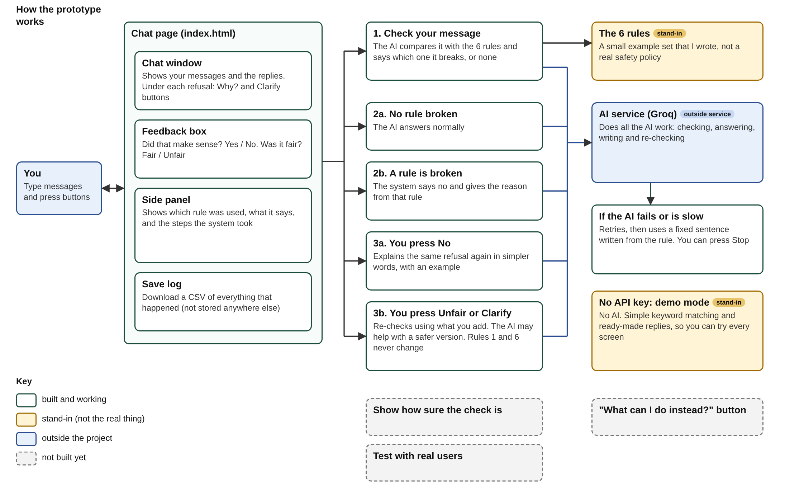

# Refusal chatbot: a chatbot that explains its refusals

**Report word count:** abstract 247, main report 959 (total 1,206; limit 1,400).
**Module:** Intelligent Interactive Systems, Assignment 2.

When a chatbot says no, this prototype shows *which rule* caused it. The user can open the exact rule (Why?), add context for a re-check (Clarify), and answer two yes/no questions: "Did that make sense?" and "Was it fair?". Each answer changes what the system does next.

## Status

| Part | Status |
|---|---|
| One-page web app: chat window and side panel | Implemented |
| Rule check: an AI model (Groq) says which of six rules a message breaks, or none | Implemented |
| Refusal written from the rule that fired; Why? shows the exact rule text | Implemented |
| Feedback box: understood Yes/No, fair Fair/Unfair | Implemented |
| "No" gives a simpler explanation; "Unfair" or Clarify re-checks with your context | Implemented |
| Rules R1 and R6 cannot be appealed | Implemented |
| Side panel with the rule used and a step-by-step trace | Implemented |
| Timeout, retries, Stop button, fallback sentences when the AI fails | Implemented |
| Interaction log with CSV download | Implemented |
| **The six rules** | **Simulated:** a small example set I wrote, not a real safety policy |
| **Demo mode (no API key)** | **Simulated:** keyword matching and ready-made replies, no AI |
| Confidence flag on the rule check | Planned |
| "What can I do instead?" button | Planned (a partial-help result already exists in the re-check) |

## Tech stack

- HTML, CSS and plain JavaScript in one file (`index.html`). No framework, no build, no install.
- AI: [Groq](https://groq.com), through its OpenAI-compatible API, called from the browser. Default model `openai/gpt-oss-20b`.
- Tests: Node.js and Playwright with a **mocked** Groq API (`tests/test-flow.js`).

## How to run

No install and no key are needed.

1. Download or clone the repo and open `index.html` in a browser.
2. **Demo mode** is the default: no AI, but every screen works. Use the "Try these" buttons in the side panel.
3. **Live mode** (optional): create your own key at https://console.groq.com/keys (it starts with `gsk_`), paste it into the side panel, click "Load models from my key" and pick a chat model.
4. The key stays in your browser tab. It is never saved or written to a file, and no key is in this repository.
5. If the browser cannot reach Groq, the app says so and uses its fallback sentences.

## Files

- `index.html`: the whole prototype.
- `docs/`: system diagram and the three storyboards from the report.

## Development record

1. **Idea.** My Assignment 1 review found that studies measure how users feel about refusals, not whether they understand them. I dropped a study tool for researchers and chose a chatbot users interact with.
2. **Design.** I chose a refusal that names its rule, a feedback box above the chat input, a clarify step and a side panel. I compared three layouts as mockups and picked the one with the side panel. The feedback box first had three answers per question; I cut it to two so each answer triggers one response.
3. **Build.** One-file prototype with six rules, demo mode, and AI calls for checking, wording the refusal, re-explaining and re-checking.
4. **Provider change.** Gemini's free API often returned 503 "high demand" errors and one request hung. I added a timeout, retries, a Stop button and fallback sentences, then switched to Groq only.

## AI assistance

I used Claude (Anthropic) as an assistant during this project. Being specific:

- **Claude helped with:** identifying flaws in my report and finding areas of improvement in my report.

References are in the report.